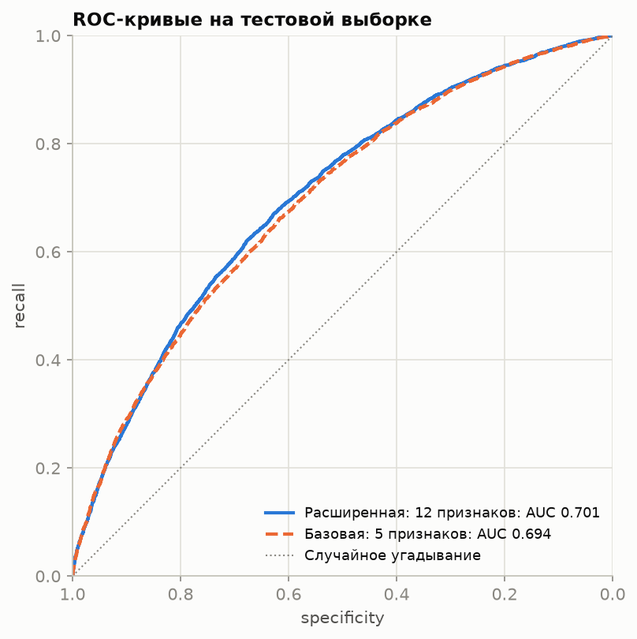
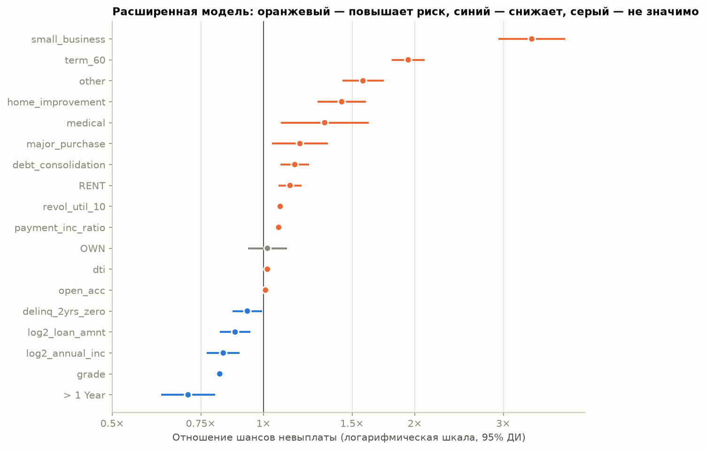
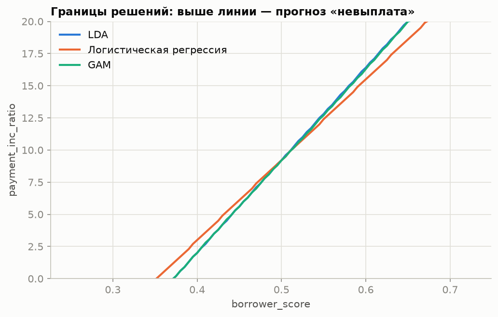

# Оценка кредитоспособности заёмщиков: логистическая регрессия

Учебный проект по кредитному скорингу: логистическая регрессия оценивает вероятность
невыплаты ссуды по данным о 45 тысячах ссуд Lending Club. Проект включает оценку качества
метриками классификации, методы работы с редким классом невыплат и сравнение базовой
модели с расширенной (12 признаков заявки) на отложенной выборке.

> **Главный результат.** Расширенная модель (12 признаков, известных в момент заявки)
> на отложенной выборке даёт **ROC-AUC 0.701, Джини 0.40** — на уровне базовой модели
> (0.694) без использования готового балла заёмщика, только на данных заявки.



## Задача

По заявке на ссуду оценить вероятность невыплаты и принять решение об одобрении.
Модель должна быть интерпретируемой: факторы, определяющие высокий риск заявки, должны
быть явными.

## Данные

| Файл | Строк | Описание |
|---|---|---|
| `data/raw/loan_data.csv.gz` | 45 342 | ссуды с ровно 50% невыплат: все невыплаты из `full_train_set` и столько же случайных погашенных ссуд |
| `data/raw/full_train_set.csv.gz` | 119 987 | ссуды с естественной долей невыплат 18.9% |
| `data/raw/loan3000.csv` | 3 000 | выборка для наглядного сравнения моделей |

Целевая переменная — `outcome`: `default` (не выплачена) или `paid off` (погашена).

## Результаты

### 1. Базовая и расширенная модели на отложенной выборке (30%)

| Модель | Столбцов* | CV ROC-AUC | ROC-AUC (test) | Джини | Accuracy | Precision | Recall | Specificity |
|---|---|---|---|---|---|---|---|---|
| Базовая: 5 признаков | 11 | 0.690 | 0.694 | 0.39 | 63.7% | 63.9% | 63.2% | 64.3% |
| **Расширенная: 12 признаков** | 18 | 0.692 | **0.701** | **0.40** | 64.8% | 65.6% | 62.4% | 67.3% |

\* Число столбцов после разбиения категорий на фиктивные переменные. Метрики
классификации посчитаны при пороге 0.5.

- **Базовая модель:** `payment_inc_ratio` (доля платежа в доходе), `purpose_` (цель ссуды),
  `home_` (жильё), `emp_len_` (стаж) и `borrower_score` (готовый балл кредитоспособности).
- **Расширенная модель:** те же признаки без `borrower_score` и 8 новых: сумма
  (`loan_amnt`), срок (`term`), доход (`annual_inc`), долговая нагрузка (`dti`),
  использование кредитного лимита (`revol_util`), рейтинг Lending Club (`grade`),
  просрочки за 2 года (`delinq_2yrs_zero`), число открытых счетов (`open_acc`).

На кросс-валидации модели практически равны: разница 0.002 меньше разброса между
фолдами (±0.006–0.007). Преимущество расширенной модели — независимость от готового
балла, способ расчёта которого в данных не описан: модель использует только данные
заявки, и каждый фактор риска интерпретируем.

### 2. Факторы риска (расширенная модель)



| Признак | Отношение шансов невыплаты |
|---|---|
| Цель: малый бизнес (к кредитной карте) | 3.42 |
| Срок 60 месяцев (к 36) | 1.94 |
| Цели: другое / ремонт / медицина | 1.58 / 1.43 / 1.32 |
| Аренда жилья (к ипотеке) | 1.13 |
| Использование лимита, +10 п.п. | 1.08 |
| Доля платежа в доходе, +1 п.п. | 1.07 |
| Долговая нагрузка `dti`, +1 п.п. | 1.017 |
| Рейтинг `grade`, +1 | 0.82 |
| Удвоение дохода | 0.83 |
| Стаж больше года | 0.71 |

### 3. Базовая модель на всех данных

На всех 45 342 ссудах базовая модель даёт ROC-AUC 0.692 (Джини 0.38). Самый сильный
признак — `borrower_score`: у заёмщиков с лучшим баллом шансы невыплаты примерно в 100 раз
ниже, чем с худшим. Ссуды малому бизнесу в 3.4 раза рискованнее ссуд на кредитную карту.

Порог отсечения определяется стоимостью ошибок. При пороге 0.4 модель находит 82%
невыплат и отказывает в 70% заявок, при пороге 0.6 — 41% невыплат и 29% отказов.

### 4. Редкий класс

На `full_train_set` (19% невыплат) модель без коррекции отмечает как невыплату только
**1%** ссуд, то есть почти все рискованные заявки прошли бы.

| Стратегия | Доля прогнозов «невыплата» |
|---|---|
| Без коррекции | 1.0% |
| Перевзвешивание (вес невыплаты ≈ 5.3) | 62.4% |
| SMOTE | 29.4% |
| ADASYN | 27.4% |

### 5. Сравнение границ решений

На двух признаках (`borrower_score` и `payment_inc_ratio`) логистическая регрессия, LDA
и GAM проводят почти одинаковую прямую границу между «выплатит» и «не выплатит».
GAM построена как `LogisticGAM(s(0, n_splines=12) + s(1, n_splines=12))` (биномиальное
распределение, логит-связь, по 12 сплайнов на признак); подбор штрафа выбрал
максимальное сглаживание (λ = 1000).



## Ход анализа

Ноутбук [`notebooks/credit_scoring.ipynb`](notebooks/credit_scoring.ipynb):

1. Данные и доля невыплат по категориям.
2. Логит и шансы.
3. Логистическая регрессия (scikit-learn): коэффициенты, отношения шансов, вероятности.
4. GLM (statsmodels): p-значения, B-сплайны, частные остатки.
5. Оценка качества: матрица ошибок, precision, recall, specificity, ROC, AUC, выбор порога.
6. Несбалансированные данные: понижающий отбор, перевзвешивание, SMOTE, ADASYN.
7. Сравнение границ решений: LDA, логистическая регрессия, GAM.
8. Расширенная модель: 8 новых признаков, сравнение с базовой на отложенной выборке и
   кросс-валидации, отношения шансов с доверительными интервалами.
9. Итоги.

## Ограничения

- Модели разделов 3–7 оценены на обучающих данных; на отложенной выборке проверены
  только модели раздела 8.
- Модели обучены на сбалансированной выборке (50% невыплат), поэтому вероятности
  завышены относительно фактической доли 19% и требуют калибровки.
- В данных нет дат выдачи, поэтому проверка на более позднем периоде (out-of-time)
  невозможна; её можно выполнить на полной версии данных Lending Club.
- Порог отсечения выбран по умолчанию (0.5), а не по стоимости ошибок.

## Структура

```
Credit_scoring/
├── README.md
├── requirements.txt
├── data/raw/                      # loan_data.csv.gz, full_train_set.csv.gz, loan3000.csv
├── notebooks/
│   ├── credit_scoring.ipynb       # анализ с результатами
│   └── _credit_scoring.py         # исходник ноутбука
├── src/py2nb.py                   # сборка .ipynb из .py
└── reports/figures/               # графики
```

## Как запустить

```bash
python3 -m venv .venv
source .venv/bin/activate
pip install -r requirements.txt
jupyter lab
```

Откройте `notebooks/credit_scoring.ipynb` → **Kernel → Restart Kernel and Run All Cells**.

## Стек

Python: pandas, NumPy, matplotlib, scikit-learn (LogisticRegression, LDA,
кросс-валидация, метрики), statsmodels (GLM, сплайны), imbalanced-learn (SMOTE, ADASYN),
pyGAM (LogisticGAM).
